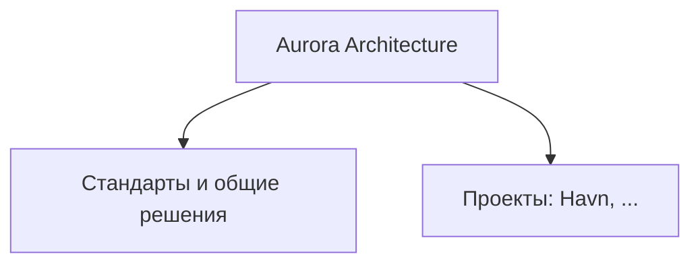
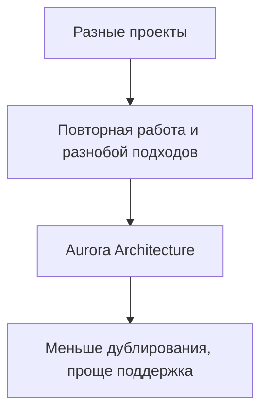
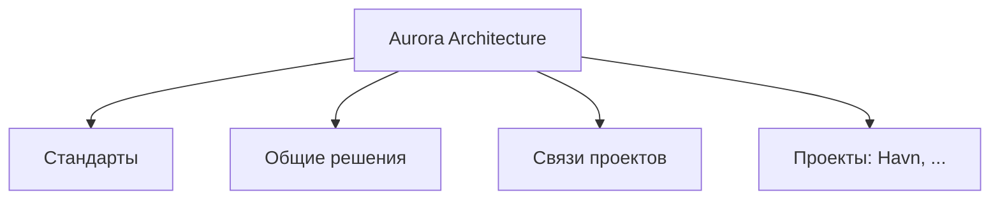
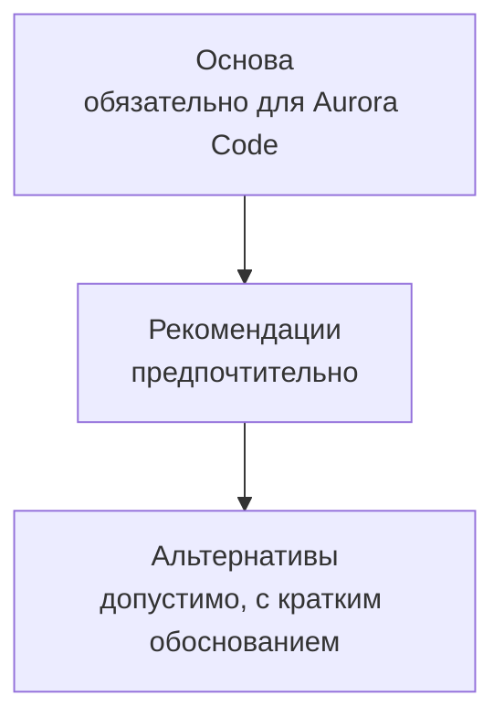
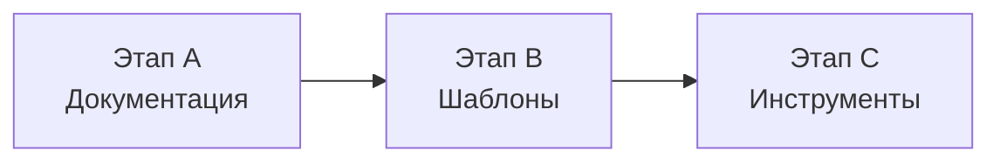

# Aurora Architecture

_Открытая экосистема разработки Aurora Code_

## 1. Что такое Aurora Architecture

Aurora Architecture — открытая экосистема разработки, создаваемая в рамках Aurora Code. Она объединяет общие стандарты, повторно используемые решения и проекты, помогая разрабатывать их по единым принципам.

Каждый проект остаётся самостоятельным и может адаптировать принципы под свои задачи. Архитектура создаётся для проектов Aurora Code, но открыта и в будущем может использоваться другими разработчиками.

## 2. Зачем она нужна

По мере роста Aurora Code проектов становится больше, и многие решают похожие задачи. Без общей основы приходится заново искать и писать одни и те же решения, проекты организуются по-разному, а удачные находки трудно переносить из одного проекта в другой.

Aurora Architecture создаётся, чтобы дать проектам общие принципы и повторно используемые решения. Единый подход и повторное использование одинаково важны: вместе они сокращают лишнюю работу и упрощают поддержку.

Она не решает все проблемы автоматически. Это основа, которая улучшается вместе с проектами.

## 3. Главные цели

1. **Единый подход.** Проекты следуют общим принципам, поэтому их проще разрабатывать и поддерживать.
2. **Повторное использование.** Полезные решения применяются в разных проектах, а не пишутся заново.
3. **Открытость.** Архитектуру можно изучать, использовать и развивать не только внутри Aurora Code.
4. **Постепенное развитие.** Новые возможности появляются тогда, когда решают реальную потребность.

## 4. Основные принципы

1. **Независимость проектов.** Каждый проект остаётся работоспособным и понятным сам по себе. Архитектура не создаёт лишних жёстких зависимостей между проектами.
2. **Гибкость.** Основные принципы общие, но проект адаптирует их под свои задачи. Общие решения рекомендуются, а при необходимости можно выбрать альтернативу, кратко объяснив причину.
3. **Практичность.** Решение становится общим, когда оно нужно нескольким проектам и проверено на практике. Так архитектура не превращается в склад всех компонентов.
4. **Простота.** Правила должны быть понятными и не превращаться в бюрократию.

## 5. Из чего состоит экосистема

1. **Стандарты.** Общие принципы разработки, организации проектов и качества.
2. **Общие решения.** Библиотеки, шаблоны и инструменты, которые проекты могут использовать. Они появляются постепенно, по мере развития.
3. **Проекты.** Havn и другие проекты Aurora Code, которые входят в экосистему.
4. **Связи между проектами.** Общие принципы и инструменты объединяют проекты всегда. Прямое техническое взаимодействие (например, обмен данными через API) появляется только там, где оно действительно нужно.

## 6. Как проекты используют общие решения

1. **Основа.** Небольшой набор базовых правил, обязательный для проектов Aurora Code. Для других разработчиков это рекомендация.
2. **Рекомендации.** Общие решения предпочтительны, но не обязательны.
3. **Альтернативы.** Проект может выбрать другой подход, если он лучше подходит. Причину достаточно кратко описать в одном-двух предложениях.

## 7. Как будет развиваться

- **Этап A. Документация.** Концепция, принципы и первоначальный набор документов.
- **Этап B. Документация и шаблоны.** Заготовки проектов с рекомендуемой структурой и настройками.
- **Этап C. Инструменты.** CLI для создания проектов, подключения общих решений и автоматической проверки стандартов.

Каждый этап даёт самостоятельный результат. К следующему переходим, когда предыдущий достаточно понятен и проверен на практике. Порядок предварительный и может меняться.

## 8. Что пока не входит

Эти вопросы сознательно оставлены на будущее, чтобы концепция оставалась простой и понятной:

- конкретные библиотеки и инструменты;
- структура репозиториев;
- CLI и автоматизация;
- лицензии и правила участия в проекте;
- технические протоколы связи между проектами;
- состав обязательной основы.
- продакшн инструкции для ии-агента

Любой из этих пунктов можно перенести в основную часть, когда он станет нужен.