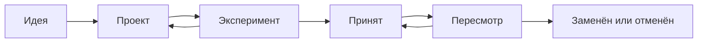

# Стандарты Aurora Architecture

> Статус документа: черновик структуры (этап A — документация).  
> Назначение: описать, как оформляются, обсуждаются и развиваются стандарты экосистемы Aurora Code.

## 1. Назначение

Стандарты Aurora Architecture задают общие инженерные принципы для проектов экосистемы. Они помогают принимать технические решения, поддерживать качество и повторно использовать проверенные решения, не лишая проекты самостоятельности.

Этот документ **не объявляет все перечисленные ниже стандарты действующими**. Каталог в разделе 5 — план возможного развития; конкретные требования вступают в силу только после отдельного утверждения.

## 2. Принципы применения

- **Независимость:** каждый проект остаётся понятным и работоспособным самостоятельно.
- **Гибкость:** общие решения предпочтительны, но обоснованные альтернативы допустимы.
- **Практичность:** стандарт появляется для решения реальной повторяющейся проблемы, а не ради формальности.
- **Простота:** требования должны быть ясными, соразмерными проекту и проверяемыми.
- **Постепенность:** стандарт сначала обсуждается и проверяется, затем при необходимости становится обязательным.

Для проектов Aurora Code утверждённая **обязательная основа** обязательна; для внешних разработчиков она носит рекомендательный характер. Остальные требования применяются в зависимости от статуса и области действия стандарта.

## 3. Как описывается стандарт

Каждый стандарт оформляется по единому шаблону:

```md
### AUR-XXX — Название

- **Статус:** идея / проект / эксперимент / принят / заменён / отменён
- **Уровень:** Core / Engineering / Ecosystem
- **Обязательность:** обязательный / рекомендуемый / условный
- **Применимость:** к каким проектам или компонентам относится
- **Цель:** какую конкретную проблему решает
- **Требование:** что именно должно соблюдаться
- **Проверка:** как подтвердить выполнение
- **Исключения:** когда допустимо отступление и как его фиксировать
- **Основание:** ссылки на решения, практику и примеры (если есть)
```

**Нумерация:** идентификатор `AUR-XXX` присваивается при регистрации стандарта и не переиспользуется. Черновые темы из каталога ниже пока не имеют официальных ID.

## 4. Жизненный цикл стандартов

1. **Идея.** Обнаружена конкретная проблема или повторяющаяся потребность.
2. **Проект.** Сформулированы требование, область применения и способ проверки.
3. **Эксперимент.** Требование проверено на реальном проекте (например, Havn); зафиксированы ограничения.
4. **Принят.** Стандарт утверждён с определённой обязательностью и областью действия.
5. **Пересмотр.** На основе практики стандарт уточняется, заменяется или отменяется.



**Как вносить изменения:** описать проблему → предложить правку → указать влияние на существующие проекты → проверить на практике, если изменение существенное → зафиксировать решение и дату. Изменения, нарушающие совместимость, не применяются молча к уже существующим проектам.

## 5. Предварительный каталог направлений

Этот список — **возможные стандарты, а не утверждённые требования**.

| Направление | Уровень | Что предполагается стандартизировать |
|---|---|---|
| Architecture Contract | Engineering | Ответственность компонентов, интерфейсы и зависимости |
| Decision Records | Engineering | Причины значимых технических решений и рассмотренные альтернативы |
| Module Boundaries | Engineering | Границы модулей, публичные контракты и допустимые зависимости |
| Change Protocol | Core | Оценка влияния изменений и контроль области задачи |
| Verification Contract | Core | Проверяемые критерии готовности, тестирование и честный отчёт |
| Failure Strategy | Engineering | Ошибки, восстановление, наблюдаемость и поведение при сбоях |
| Dependency Policy | Engineering | Выбор, обновление и проверка сторонних зависимостей |
| Reuse Policy | Ecosystem | Когда решение становится общим и как им пользоваться без жёсткой связности |

### Уровни

- **Core:** минимальные универсальные требования для проектов Aurora Code.
- **Engineering:** технические практики, применяемые там, где их сложность оправдана.
- **Ecosystem:** требования к общим библиотекам, шаблонам, инструментам и интеграциям.

Уровень и обязательность — разные характеристики: например, требование уровня Engineering может быть условным для определённых типов проектов.

## 6. Текущая основа: на пересмотр

В первой версии `STANDARDS.md` были указаны README, отсутствие секретов в репозитории и лицензия как обязательная основа; базовые проверки и единая организация проектов — как рекомендации.

Перед закреплением следующей версии нужно отдельно уточнить:

- минимальное содержание документации проекта;
- правила работы с секретами, включая историю коммитов и окружения;
- политику лицензирования (особенно для закрытых и внутренних проектов);
- минимальные критерии проверки изменений;
- какие единые соглашения действительно нужны разным технологическим стекам.

До такого решения новый каталог не заменяет автоматически ранее согласованные требования.

## 7. Как проекты применяют стандарты

Проект указывает используемые стандарты и допустимые отступления в своей документации (`PROJECT.md` либо другой выбранный файл). Для обоснованного исключения достаточно кратко записать причину, последствия и, если нужно, альтернативный способ проверки.

Общие библиотеки и инструменты не становятся обязательной зависимостью проекта только потому, что они входят в Aurora Architecture.

## 8. Связь с развитием Aurora Architecture

- **Этап A — документация:** определить термины, шаблон, жизненный цикл и первые проверяемые стандарты.
- **Этап B — шаблоны:** воплотить принятые стандарты в необязательных заготовках проектов.
- **Этап C — инструменты:** автоматизировать проверки тех стандартов, которые реально можно проверить без ложных срабатываний.

Эти этапы описывают направление развития, но не обязывают заранее создавать CLI, библиотеки или сложную инфраструктуру.

## 9. Правила для ИИ-агентов

Инструкции для Cursor — отдельная часть стандартов Aurora. Они должны помогать соблюдать утверждённые требования, но не подменяют архитектурные решения, документацию проекта и реальные проверки. Наборы `aurora-base.mdc` и уровней `learning` / `development` развиваются отдельно от этого каталога.

---

_Документ дополняется по мере практического опыта. Новые идеи не становятся обязательными автоматически._
